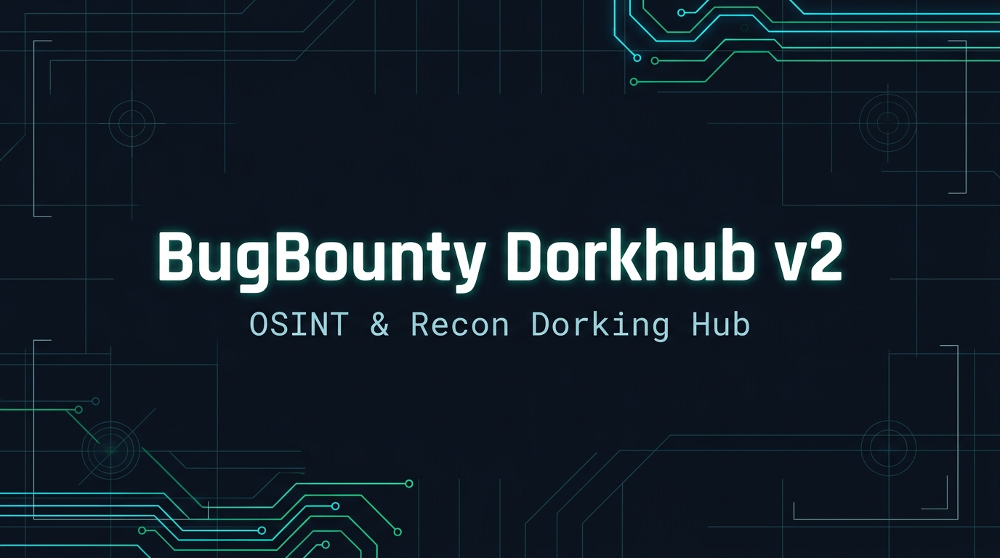

# 🎯 BugBounty Dorkhub v2.0

> **Advanced Search Dorking Toolkit with Chrome and Firefox Extensions for Multi-Tab Operations & URL Extraction**


---

## ⚠️ Disclaimer

> **Legal & Ethical Use Only:**  
> BugBounty Dorkhub v2.0 is designed strictly for **authorized security testing, bug bounty hunting within program scope, and educational research**.  
> - Always verify that you have explicit permission (such as an active bug bounty program or written authorization) before testing any target domain or organization.  
> - The author(s) are **not responsible** for any misuse, unauthorized access, or damage caused by this tool.  
> - Use responsibly and in compliance with all applicable laws and platform terms of service.

---

## 📋 What Is This Project?

**BugBounty Dorkhub v2.0** is a zero-dependency, browser-based reconnaissance hub that centralizes **Google/DuckDuckGo Dorks**, **GitHub & GitLab Secret Hunting**, and **Infrastructure OSINT** (Shodan, Censys) into a single interactive dashboard.

Instead of manually typing or copying dozens of search queries per target, Dorkhub lets you enter a target domain (and optionally a GitHub organization), launch curated dorks with one click, and **track your recon progress per domain** in `localStorage`.

### 🧩 Included Components

1. **Web Dashboard (`index.html`, `script.js`, `style.css`)**:  
   Categorized dorks focused on **IDOR**, **Broken Access Control**, **API Discovery**, **Sensitive Data & Credentials**, **Cloud/DevOps**, and **Infrastructure**. Runs locally without any backend or build step.
2. **Dorkhub Helper Extensions (`chrome-extension/`, `firefox-extension-dorkhub/`)**:  
   Browsers block `window.open()` when opening multiple tabs at once. These extensions add **"OPEN CATEGORY"** buttons to the dashboard so you can launch an entire category of dorks in one click.
3. **Search URL Extractor Extensions (`ddg-url-extractor/`, `firefox-ddg-url-extractor/`)**:  
   Companion extensions to extract and collect result URLs directly from search engine pages for faster triage.

> ℹ️ **Note**: The dorks compiled in this tool are gathered from public sources shared by the Bug Bounty and information security community.

---

## ✨ Main Features

### 🎯 Core Functionalities

- **🚀 Browser Extensions (Chrome + Firefox)**: Open entire categories of dorks at once (bypasses popup blockers)
- **Targeted Reconnaissance**: Specialized dorks focused on IDOR, Broken Access Control, and API hunting
- **Multi-Platform Support**: Google, DuckDuckGo, Shodan, Censys, GitHub, GitLab, and direct web tools
- **Progress Tracking**: Automatically marks executed dorks with visual indicators (green highlight)
- **Data Persistence**: Progress is saved in localStorage per domain
- **Selective Reset**: Reset progress by category or completely
- **Modern Interface**: Futuristic dark theme with smooth animations and responsive design
- **No Dependencies**: Pure HTML, CSS, and JavaScript

---

## 🔌 Browser Extensions

### Why an Extension?

Regular JavaScript `window.open()` calls are blocked by browsers when opening multiple tabs. Our browser extensions **bypass popup blockers** using browser APIs.

### Installation (Chrome / Firefox)

1. **Chrome**: Open `chrome://extensions/`
2. Enable **Developer mode**
3. Click **Load unpacked** and select `chrome-extension/`

4. **Firefox**: Open `about:debugging#/runtime/this-firefox`
5. Click **Load Temporary Add-on...** and select `firefox-extension-dorkhub/manifest.json`
6. ✅ Extension installed!

### Usage

Once installed, you'll see green **"OPEN CATEGORY"** buttons in each section:

1. Enter target domain (e.g., `example.com`)
2. Select search engine (`Google` o `DuckDuckGo`) in the header
3. Click **"OPEN CATEGORY"** on any section
4. Confirm the number of tabs to open
5. All dorks open automatically without popup blocks! 🎉

### Extension Features

- ✅ Bypasses popup blockers completely
- ✅ Opens unlimited tabs
- ✅ Auto-marks buttons as completed
- ✅ Integrates seamlessly with the UI
- ✅ Works on localhost and file:// URLs

📖 **Full documentation**: See [chrome-extension/README.md](chrome-extension/README.md)

---

## 🚀 Quick Start

### Option 1: Local Use

```bash
# Clone repository
git clone https://github.com/0xRh4ps00dy/bugbounty-dorkhub-v2.git

# Navigate to directory
cd bugbounty-dorkhub-v2

# Open in browser
open index.html  # macOS/Linux
# or double-click index.html on Windows
```

### Option 2: Online Use

Simply download and open `index.html` in your browser. No server required!

### Basic Workflow

1. **Enter target domain** (e.g., `example.com`)
2. **Click individual dork buttons** OR **use browser extension** to open entire categories
3. **Results open in new tabs** automatically
4. **Buttons highlight green** when executed
5. **Progress saves automatically** per domain

---

## 📁 Project Structure

```
bugbounty-dorkhub-v2/
│
├── index.html              # Main interface with all categories
├── script.js               # Core functionality and dork execution
├── style.css               # Futuristic dark theme styling
│
├── chrome-extension/       # Chrome helper extension (Open Category)
│   ├── manifest.json       # Extension configuration
│   ├── background.js       # Tab management service worker
│   ├── content.js          # Injects "OPEN CATEGORY" buttons
│   ├── popup.html          # Extension popup interface
│   ├── popup.css           # Popup styling
│   ├── popup.js            # Popup logic
│   └── README.md           # Extension documentation
│
├── firefox-extension-dorkhub/   # Firefox helper extension (Open Category)
├── ddg-url-extractor/           # Search URL Extractor (Chrome)
├── firefox-ddg-url-extractor/   # Search URL Extractor (Firefox)
├── dist/                        # Packaged .zip/.xpi builds
│
├── README.md               # This file
└── EXTENSION-GUIDE.md      # Detailed extension guide
```

---

## 🗂️ Dork Categories

### 1. **Search Engines & Platforms** (6 dorks)
- DuckDuckGo, Google, Shodan, Censys, GitHub, GitLab searches

### 2. **Vulnerability Discovery** (6 dorks)
- Directory listings, config files, database files, log files, backups, backdoors

### 3. **Authentication & Access** (5 dorks)
- Login pages, admin panels, dashboards, registration, auth pages

### 4. **Web Application Testing** (6 dorks)
- WordPress, SQL errors, phpinfo, install/setup pages, open redirects, Apache Struts

### 5. **API Endpoints & Reconnaissance** (10 dorks)
- API docs, endpoints, GitLab, .git folders, WP JSON, Swagger UI, GraphQL

### 6. **GitHub Secret Hunting** (9 dorks)
- Domain searches, swagger.json files, API keys, tokens, secrets in repositories

### 7. **Bug Bounty Programs** (4 dorks)
- Security.txt, responsible disclosure, VRP programs

---

## 🎯 Specialized For

✅ **IDOR** (Insecure Direct Object References)  
✅ **Broken Access Control**  
✅ **API Discovery & Enumeration**  
✅ **Credential & API Key Exposure**  
✅ **Configuration File Leakage**  
✅ **Directory Listing Vulnerabilities**  
✅ **Admin Panel Detection**  
✅ **GitHub Secret Hunting**  

---

## 🛠️ Technologies Used

- **HTML5**: Semantic structure with `<details>` elements
- **CSS3**: Grid/Flexbox, gradients, animations, futuristic theme
- **JavaScript (Vanilla)**: No frameworks, no dependencies
- **LocalStorage API**: Progress persistence
- **Browser Extension APIs (Chrome + Firefox)**: Multi-tab operations and result extraction

---
## ⚖️ Legal Notice & Responsible Use

⚠️ **AUTHORIZED USE ONLY**: This tool is designed **exclusively** for:

- ✅ Authorized Bug Bounty programs
- ✅ Authorized penetration testing with written permission
- ✅ Security research on systems you own
- ✅ Educational purposes in controlled environments

**PROHIBITED USES**:

- ❌ Unauthorized access to systems
- ❌ Illegal activities or malicious intent
- ❌ Violating Terms of Service
- ❌ Accessing systems without explicit permission
- ❌ Any activity that violates local, state, or federal laws

> **Disclaimer**: The author and contributors are not responsible for misuse of this tool. Users are solely responsible for ensuring their activities are legal and authorized.

---

## 🔄 Version History

### v2.0 (Current - 2026)
- 🚀 **NEW**: Chrome Extension for multi-tab opening
- 🎯 Focused categories (Vulnerability Discovery, Authentication, API, GitHub)
- 🔧 Restructured with optimized sections
- 📱 Improved responsive design
- 💾 Enhanced progress tracking
- 🎨 Futuristic dark theme refinement

### v1.0 (2025)
- Initial release with 88+ dorks
- Basic progress tracking
- Multiple unfocused categories

---

## 🙏 Credits & Acknowledgments

This tool is a compilation of publicly shared techniques from the Bug Bounty and information security community.

**Dorks sourced from**:
- Bug Bounty Hunter blogs and write-ups
- Cybersecurity forums (Reddit, Discord, Twitter)
- Public GitHub repositories
- Ethical hacking tutorials and guides
- Open-source intelligence (OSINT) resources

**Special thanks** to the entire Bug Bounty community that openly shares knowledge and helps improve security for everyone.

---

## 🤝 Contributing

Contributions are welcome! If you have useful dorks or improvements:

1. **Fork** the repository
2. **Create** a feature branch (`git checkout -b feature/new-dork`)
3. **Commit** your changes (`git commit -m 'Add: new XSS dork'`)
4. **Push** to the branch (`git push origin feature/new-dork`)
5. **Open** a Pull Request

### Contribution Guidelines

- Keep dorks focused on security research
- Test dorks before submitting
- Provide clear descriptions
- Follow existing code style
- Update documentation

---

## 📧 Contact & Support

- **GitHub**: [@0xRh4ps00dy](https://github.com/0xRh4ps00dy)
- **Project**: [BugBounty Dorkhub v2.0](https://github.com/0xRh4ps00dy/bugbounty-dorkhub-v2)
- **Issues**: [Report bugs or request features](https://github.com/0xRh4ps00dy/bugbounty-dorkhub-v2/issues)

---

## 📜 License

This project is distributed under the **MIT License**. See `LICENSE` file for details.

```
MIT License - Free for educational and authorized security research
```

---

## 🌟 Show Your Support

If you find this tool useful:

⭐ **Star this repository** on GitHub  
🔄 **Share** with the Bug Bounty community  
🐛 **Report issues** to help improve the tool  
💡 **Contribute** new dorks and features  

---

<div align="center">

**🎯 Happy Hunting! 🔐**

*For educational and authorized security research only*

Made with ❤️ by [0xRh4ps00dy](https://github.com/0xRh4ps00dy)

</div>

